# Migración de GitLab a GitHub

> Script principal: `migrar_repositorios.sh`

Este documento describe la configuración, ejecución y validación del proceso de migración de repositorios desde GitLab hacia una cuenta personal de GitHub.

---

## Scripts incluidos

Este README documenta **dos scripts distintos y complementarios**:

| Orden | Script | Propósito | Cuándo se ejecuta |
|---|---|---|---|
| **1** | `migrar_repositorios.sh` | Ejecuta la migración GitLab → GitHub. | Primero. |
| **2** | `validar_integridad_migracion.sh` | Certifica que la migración realizada por el Script 1 sea íntegra y que los componentes configurados existan en GitHub. | Después de la migración. |

```text
SCRIPT 1                                              SCRIPT 2
Migración                                             Certificación

migrar_repositorios.sh                                validar_integridad_migracion.sh
          │                                                        │
          ▼                                                        ▼
GitLab ───────────────► GitHub                          GitLab ◄──── comparación ────► GitHub
          │                                                        │
          ├─ Git                                                    ├─ ramas / tags / commits
          ├─ Variables / Secrets                                    ├─ git fsck
          ├─ Environments                                           ├─ Variables / Secrets
          ├─ Branch Protection                                      ├─ Environments / Policies
          ├─ Miembros                                                ├─ Branch Protection
          ├─ Git LFS                                                 ├─ Miembros
          └─ Pipelines                                               ├─ Pipelines
                                                                   └─ Git LFS
```

> [!IMPORTANT]
> **No son dos modos del mismo script.** El Script 1 migra. El Script 2 valida/certifica el resultado de la migración.

---

## Índice

### PARTE I — Script 1: `migrar_repositorios.sh`

- [1. Alcance](#1-alcance)
- [2. Flujo general](#2-flujo-general)
- [3. Requisitos](#3-requisitos)
- [4. Ejecución](#4-ejecución)
- [5. Variables obligatorias](#5-variables-obligatorias)
- [6. Selección de repositorios](#6-selección-de-repositorios)
- [7. Variables con valores por defecto](#7-variables-con-valores-por-defecto)
- [8. Variables y Secrets](#8-variables-y-secrets)
- [9. Branch Protection Rules](#9-branch-protection-rules)
- [10. Miembros y permisos](#10-miembros-y-permisos)
- [11. Git LFS](#11-git-lfs)
- [12. Pipelines](#12-pipelines)
- [13. Logs y reportes](#13-logs-y-reportes)
- [14. Configuraciones de ejemplo](#14-configuraciones-de-ejemplo)
- [15. Errores frecuentes](#15-errores-frecuentes)
- [16. Recomendaciones operativas](#16-recomendaciones-operativas)
- [17. Criterios para pasar a certificación](#17-criterios-de-certificación)

### PARTE II — Script 2: `validar_integridad_migracion.sh`

- [18. Validación de integridad de la migración](#18-validación-de-integridad-de-la-migración)

### PARTE III — Ejecución conjunta

- [19. Ejecución recomendada de punta a punta](#19-ejecución-recomendada-de-punta-a-punta)

---
## Ejecución rápida de los dos scripts

```bash
# Cargar la misma configuración para ambos procesos
source migracion.env

# SCRIPT 1: ejecutar la migración
chmod +x migrar_repositorios.sh
./migrar_repositorios.sh

# SCRIPT 2: validar/certificar lo migrado
chmod +x validar_integridad_migracion.sh
./validar_integridad_migracion.sh
```

> [!TIP]
> Se recomienda utilizar el mismo `migracion.env` en ambos scripts para que el validador sepa exactamente qué componentes debía migrar y, por tanto, qué debe certificar.

---

# PARTE I — SCRIPT 1: MIGRACIÓN

## `migrar_repositorios.sh`

**Objetivo:** migrar repositorios y configuración seleccionada desde GitLab hacia GitHub.

**Resultado esperado:** repositorio GitHub creado y poblado, junto con los componentes opcionales habilitados por configuración.

---

## 1. Alcance

El script `migrar_repositorios.sh` realiza una migración de repositorios desde GitLab hacia una cuenta personal de GitHub.

### Capacidades incluidas

| Dominio | Capacidad |
|---|---|
| Git | Migra ramas, tags e historial de commits. |
| GitHub | Crea repositorios privados. |
| Rama predeterminada | Sincroniza en GitHub la rama predeterminada de GitLab. |
| Variables y Secrets | Migra variables de GitLab hacia GitHub Actions Variables o Secrets. |
| Environments | Crea GitHub Environments a partir de `environment_scope`. |
| Deployment Branch Policies | Configura ramas permitidas para cada GitHub Environment. |
| Branch Protection | Migra reglas básicas de protección de ramas. |
| Miembros | Migra miembros y permisos de repositorio. |
| Git LFS | Detecta, preserva o convierte archivos a Git LFS. |
| Pipelines | Audita o migra GitLab CI/CD mediante GitHub Actions Importer. |
| Auditoría | Genera logs, reportes de LFS, pipelines y conflictos de miembros. |

> [!IMPORTANT]
> La migración de Branch Protection Rules es **básica**. No todas las capacidades de GitLab tienen equivalencia automática en GitHub.

---

## 2. Flujo general

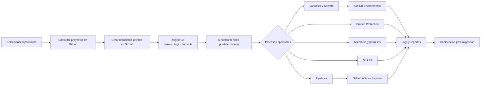

### Orden recomendado de ejecución

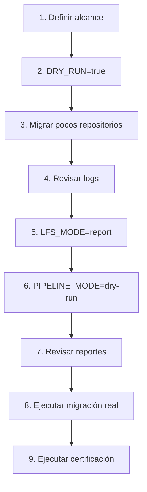

---

## 3. Requisitos

### 3.1 Requisitos base

El equipo donde se ejecuta el script debe contar con:

```text
bash
curl
jq
git
mktemp
awk
sed
sort
tee
grep
```

Verificación rápida:

```bash
bash --version
curl --version
jq --version
git --version
```

### 3.2 Requisitos condicionales

| Herramienta | Cuándo se requiere |
|---|---|
| `gh` | Cuando `MIGRATE_VARIABLES=true` o `MIGRATE_PIPELINES=true`. |
| `git-lfs` | Cuando `LFS_MODE=preserve` o `LFS_MODE=migrate`. |
| `docker` | Cuando `MIGRATE_PIPELINES=true`. |
| `gh actions-importer` | Cuando `MIGRATE_PIPELINES=true`. |

Verificación:

```bash
gh --version
git lfs version
docker --version
gh actions-importer --help
```

---

## 4. Ejecución

Dar permisos de ejecución:

```bash
chmod +x migrar_repositorios.sh
```

Ejecutar:

```bash
./migrar_repositorios.sh
```

También se puede cargar la configuración desde un archivo:

```bash
source migracion.env
./migrar_repositorios.sh
```

> [!CAUTION]
> No almacenes tokens reales dentro del README ni los confirmes en Git. Mantén `TOKEN_GITLAB` y `TOKEN_GITHUB` fuera del repositorio.

---

## 5. Variables obligatorias

Estas variables deben estar definidas antes de ejecutar el script.

| Variable | Descripción | Ejemplo |
|---|---|---|
| `GITLAB_URL` | URL base del servidor GitLab. | `http://gitlab.bancoexterior.com` |
| `TOKEN_GITLAB` | Token GitLab con acceso API y permisos de lectura sobre los repositorios. | `glpat-xxxxxxxx` |
| `TOKEN_GITHUB` | Token GitHub con permisos de creación, administración y escritura en repositorios. | `github_pat_xxxxxxxx` |

Ejemplo:

```bash
export GITLAB_URL="http://gitlab.bancoexterior.com"
export TOKEN_GITLAB="glpat-xxxxxxxx"
export TOKEN_GITHUB="github_pat_xxxxxxxx"
```

El usuario personal de GitHub se detecta automáticamente desde `TOKEN_GITHUB`; no configures `OWNER`. Si quedó definido con el nombre de una organización, el script lo ignora y usa el usuario autenticado.

---

## 6. Selección de repositorios

El script permite seleccionar repositorios mediante `GROUP_GITLAB` o `REPOSITORIES_FILE`. La cuenta personal detectada en GitHub es independiente de esta selección: puedes migrar un grupo de GitLab hacia tu cuenta personal de GitHub.

> [!NOTE]
> Aunque la variable se denomina `REPOSITORIES_FILE`, su valor **no es una ruta a un archivo**. Recibe una lista de repositorios o IDs separados por coma.

### 6.1 Migrar un grupo GitLab

```bash
source migracion.env
unset REPOSITORIES_FILE
export GROUP_GITLAB="nombre-del-grupo"
./migrar_repositorios.sh
```

En Git Bash, reemplaza `nombre-del-grupo` por el grupo que quieras migrar cada vez que ejecutes el proceso. Carga primero `migracion.env`; así el valor que exportes después será el que use el script. `unset REPOSITORIES_FILE` evita que una lista configurada anteriormente tenga prioridad sobre el grupo. El script también consulta los proyectos de los subgrupos y el token de GitLab debe tener acceso al grupo.

Si tus repositorios están directamente bajo tu usuario de GitLab y no dentro de un grupo, usa `REPOSITORIES_FILE` en lugar de `GROUP_GITLAB`.

Si `GROUP_GITLAB` no está definida y `REPOSITORIES_FILE` tampoco, el script consultará todos los repositorios visibles para `TOKEN_GITLAB`.

> [!IMPORTANT]
> Se recomienda definir siempre `GROUP_GITLAB` o `REPOSITORIES_FILE` para limitar el alcance de la migración.

### 6.2 Migrar repositorios específicos

Lista de repositorios separados por coma:

```bash
export REPOSITORIES_FILE="mi-usuario/api-clientes,mi-usuario/web,mi-usuario/notificaciones"
```

También se pueden usar IDs de proyectos GitLab:

```bash
export REPOSITORIES_FILE="125,126,127"
```

Ejemplo combinado:

```bash
export REPOSITORIES_FILE="banco/api-clientes,125,banco/canales/web"
```

Cada valor puede ser:

```text
grupo/proyecto
grupo/subgrupo/proyecto
123
```

Cuando `REPOSITORIES_FILE` tiene valor:

- Tiene prioridad sobre `GROUP_GITLAB`.
- El script crea internamente un archivo temporal de selección.
- Cada repositorio se consulta directamente en GitLab.
- Los repositorios duplicados se eliminan antes de iniciar la migración.

Incorrecto:

```bash
export REPOSITORIES_FILE="./repositorios.txt"
```

Correcto:

```bash
export REPOSITORIES_FILE="grupo/repositorio-a,grupo/repositorio-b,123"
```

### Precedencia de selección

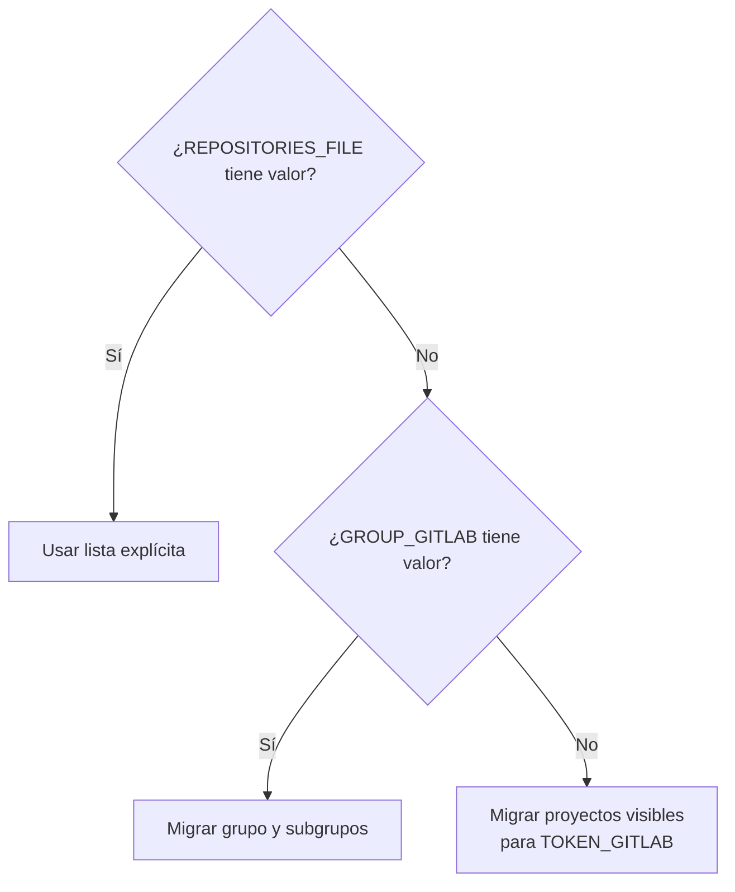

---

## 7. Variables con valores por defecto

Estas variables no necesitan ser exportadas si sus valores por defecto son adecuados.

| Variable | Valor por defecto | Descripción |
|---|---|---|
| `GROUP_GITLAB` | Vacío | Grupo GitLab a migrar. Para proyectos personales, déjalo vacío o usa `REPOSITORIES_FILE`. Si está vacío, se consultan todos los proyectos visibles para el token. |
| `REPOSITORIES_FILE` | Vacío | Lista de repositorios separados por coma. Tiene prioridad sobre `GROUP_GITLAB`. |
| `GITHUB_API_URL` | `https://api.github.com` | URL de API GitHub. |
| `ALLOW_MIRROR_OVERWRITE` | `false` | Define si se puede migrar sobre un repositorio GitHub existente. |
| `DRY_RUN` | `false` | Simula la migración sin crear repositorios ni hacer push. |
| `SYNC_DEFAULT_BRANCH` | `true` | Configura en GitHub la misma rama predeterminada de GitLab. |
| `MIGRATE_VARIABLES` | `false` | Activa migración de Variables y Secrets. |
| `VARIABLES_REQUIRED` | `false` | Define si un error de variables hace fallar el repositorio. |
| `GITHUB_ACTIONS_VARIABLES` | Vacío | Variables GitLab que se migran como GitHub Actions Variables. |
| `MIGRATE_ENVIRONMENT_SCOPED_VARIABLES` | `false` | Activa migración de variables GitLab con `environment_scope`. |
| `CREATE_GITHUB_ENVIRONMENTS` | `true` | Crea GitHub Environments cuando corresponda. |
| `CREATE_ENVIRONMENT_BRANCH_POLICIES` | `false` | Crea políticas de ramas permitidas en Environments. |
| `ALLOW_DIRECT_ENVIRONMENT_SCOPE_MAPPING` | `false` | Usa el scope GitLab como Environment GitHub directamente. |
| `ENVIRONMENT_MAPPING_FILE` | Vacío | Archivo de mapeo GitLab Environment Scope → GitHub Environment. |
| `MIGRATE_BRANCH_PROTECTIONS` | `false` | Activa migración de protecciones de rama. |
| `BRANCH_PROTECTIONS_REQUIRED` | `false` | Define si una falla de protección hace fallar el repositorio. |
| `MIGRATE_REPOSITORY_MEMBERS` | `false` | Activa migración de miembros. |
| `MEMBERS_REQUIRED` | `false` | Define si una falla de miembros hace fallar el repositorio. |
| `ALLOW_GITHUB_ADMIN_PERMISSION` | `false` | Permite otorgar permisos administrativos si se requieren. |
| `GITHUB_USERNAME_SUFFIX` | `_bexca` | Sufijo agregado al username GitLab para buscar el usuario en GitHub. |
| `LFS_MODE` | `report` | Modo de análisis o migración Git LFS. |
| `LFS_THRESHOLD_MB` | `50` | Tamaño mínimo en MB para reportar blobs grandes. |
| `LFS_INCLUDE_PATTERNS` | `*.jar,*.war,*.zip,*.tar,*.tar.gz` | Patrones usados para migrar archivos a LFS. |
| `ALLOW_HISTORY_REWRITE` | `false` | Autoriza reescritura de historial para migración LFS. |
| `MIGRATE_PIPELINES` | `false` | Activa GitHub Actions Importer. |
| `PIPELINE_MODE` | `dry-run` | Modo de análisis o migración de pipelines. |
| `PIPELINES_REQUIRED` | `false` | Define si un error de pipelines hace fallar el repositorio. |
| `PIPELINE_BRANCHES` | `master,main,dev,qa` | Ramas candidatas para buscar `.gitlab-ci.yml`. |
| `CONFIGURE_ACTIONS_IMPORTER` | `false` | Ejecuta configuración interactiva de Actions Importer. |
| `AUDIT_PIPELINES` | `true` | Ejecuta auditoría de GitLab CI/CD. |
| `LOG_DIRECTORY` | `./logs` | Directorio principal de logs. |
| `LOG_FILE` | Archivo con fecha y hora | Archivo de log principal. |
| `PIPELINE_REPORT_DIRECTORY` | Directorio con fecha y hora | Directorio de reportes de pipelines. |
| `LFS_REPORT_DIRECTORY` | Directorio con fecha y hora | Directorio de reportes LFS. |
| `MEMBER_CONFLICTS_FILE` | Archivo TSV con fecha y hora | Archivo de conflictos de miembros. |

---

## 8. Variables y Secrets

### 8.1 Variables de control

| Variable | Cuándo aplica | Efecto |
|---|---|---|
| `MIGRATE_VARIABLES` | Cuando es `true`. | Migra Variables y Secrets desde GitLab a GitHub. |
| `VARIABLES_REQUIRED` | Cuando `MIGRATE_VARIABLES=true`. | Si es `true`, una falla de variables marca el repositorio como fallido. |
| `GITHUB_ACTIONS_VARIABLES` | Cuando `MIGRATE_VARIABLES=true`. | Define qué variables se migran como Variables de GitHub Actions en lugar de Secrets. |
| `MIGRATE_ENVIRONMENT_SCOPED_VARIABLES` | Cuando `MIGRATE_VARIABLES=true`. | Migra variables GitLab con scope distinto de `*`. |
| `CREATE_GITHUB_ENVIRONMENTS` | Cuando existen variables con Environment Scope. | Crea Environments en GitHub. |
| `CREATE_ENVIRONMENT_BRANCH_POLICIES` | Cuando existen Environments y mapping de ramas. | Crea políticas de ramas permitidas en el Environment. |
| `ENVIRONMENT_MAPPING_FILE` | Cuando scopes GitLab y Environments GitHub tienen nombres distintos. | Mapea scopes GitLab hacia Environments GitHub. |
| `ALLOW_DIRECT_ENVIRONMENT_SCOPE_MAPPING` | Cuando no se usa archivo de mapeo. | Usa directamente el nombre del scope GitLab como Environment GitHub. |

### 8.2 Flujo de migración

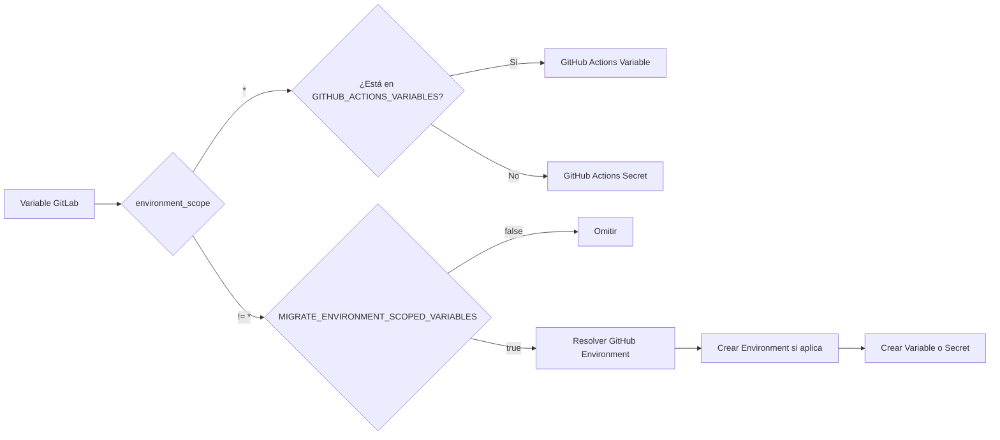

### 8.3 Variables simples

```bash
export MIGRATE_VARIABLES="true"
export MIGRATE_ENVIRONMENT_SCOPED_VARIABLES="false"
```

Esto migra únicamente variables GitLab con:

```text
environment_scope=*
```

### 8.4 Variables y Secrets de GitHub Actions

```bash
export MIGRATE_VARIABLES="true"
export GITHUB_ACTIONS_VARIABLES="APP_NAME,APP_URL,ENVIRONMENT,LOG_LEVEL"
```

Las variables indicadas en `GITHUB_ACTIONS_VARIABLES` se migran como Variables. Las restantes se migran como Secrets.

### 8.5 Variables por Environment

```bash
export MIGRATE_VARIABLES="true"
export MIGRATE_ENVIRONMENT_SCOPED_VARIABLES="true"
export CREATE_GITHUB_ENVIRONMENTS="true"
export CREATE_ENVIRONMENT_BRANCH_POLICIES="true"
export ENVIRONMENT_MAPPING_FILE="./environment-mapping.tsv"
```

Contenido de `environment-mapping.tsv`:

```text
dev|development|dev
qa|quality-assurance|qa
production|production|main
```

Formato:

```text
gitlab_scope|github_environment|allowed_branches
```

---

## 9. Branch Protection Rules

| Variable | Cuándo aplica | Efecto |
|---|---|---|
| `MIGRATE_BRANCH_PROTECTIONS` | Cuando es `true`. | Migra protecciones básicas de ramas GitLab hacia GitHub. |
| `BRANCH_PROTECTIONS_REQUIRED` | Cuando `MIGRATE_BRANCH_PROTECTIONS=true`. | Si es `true`, una falla de protecciones marca el repositorio como fallido. |

Ejemplo:

```bash
export MIGRATE_BRANCH_PROTECTIONS="true"
export BRANCH_PROTECTIONS_REQUIRED="false"
```

### Se migra actualmente

- Nombre exacto de rama.
- Force push permitido o bloqueado.
- Aprobación de Code Owners.
- Mínimo de una aprobación cuando Code Owners es obligatorio.

### No se migra automáticamente

- Wildcards, por ejemplo `release/*`.
- Usuarios o grupos autorizados a hacer push.
- Usuarios o grupos autorizados a hacer merge.
- Approval Rules de Merge Requests.
- Pipelines obligatorios.
- Status checks.
- Restricciones detalladas por rol.

> [!WARNING]
> Después de la migración se debe revisar manualmente el gobierno de ramas y, cuando corresponda, complementar la configuración con Rulesets o protecciones adicionales de GitHub.

---

## 10. Miembros y permisos

| Variable | Cuándo aplica | Efecto |
|---|---|---|
| `MIGRATE_REPOSITORY_MEMBERS` | Cuando es `true`. | Consulta miembros GitLab e invita o actualiza colaboradores GitHub. |
| `MEMBERS_REQUIRED` | Cuando `MIGRATE_REPOSITORY_MEMBERS=true`. | Si es `true`, una falla de miembros marca el repositorio como fallido. |
| `GITHUB_USERNAME_SUFFIX` | Cuando `MIGRATE_REPOSITORY_MEMBERS=true`. | Sufijo agregado al username GitLab para formar el username GitHub. |
| `ALLOW_GITHUB_ADMIN_PERMISSION` | Cuando se asignan permisos elevados. | Permite permisos administrativos si se requieren. |

Ejemplo:

```bash
export MIGRATE_REPOSITORY_MEMBERS="true"
export MEMBERS_REQUIRED="false"
export GITHUB_USERNAME_SUFFIX="_bexca"
```

Conversión esperada de usuario:

```text
GitLab: jperez
GitHub: jperez_bexca
```

### Conversión de permisos

| Nivel GitLab | Permiso GitHub |
|---|---|
| Guest | `pull` |
| Reporter | `pull` |
| Developer | `push` |
| Maintainer | `maintain` |
| Owner | `maintain` |

Los conflictos de usuarios se registran en:

```bash
${MEMBER_CONFLICTS_FILE}
```

---

## 11. Git LFS

| Variable | Cuándo aplica | Efecto |
|---|---|---|
| `LFS_MODE` | Siempre se evalúa. | Define cómo se manejan blobs grandes y objetos Git LFS. |
| `LFS_THRESHOLD_MB` | Con `LFS_MODE=report` o `migrate`. | Umbral de tamaño para reportar blobs grandes. |
| `LFS_INCLUDE_PATTERNS` | Con `LFS_MODE=migrate`. | Patrones de archivos a convertir a Git LFS. |
| `ALLOW_HISTORY_REWRITE` | Con `LFS_MODE=migrate`. | Autoriza la reescritura de historial Git. |

### Modos disponibles

| Valor | Descripción |
|---|---|
| `off` | No analiza ni procesa LFS. |
| `report` | Genera reporte de blobs grandes sin modificar historial. |
| `preserve` | Copia objetos LFS existentes desde GitLab hacia GitHub. |
| `migrate` | Convierte archivos a LFS y reescribe el historial Git. |

Modo inicial recomendado:

```bash
export LFS_MODE="report"
```

Conversión a LFS:

```bash
export LFS_MODE="migrate"
export ALLOW_HISTORY_REWRITE="true"
export LFS_INCLUDE_PATTERNS="*.jar,*.war,*.zip,*.iso"
```

> [!CAUTION]
> `LFS_MODE=migrate` modifica hashes Git. Debe ejecutarse únicamente sobre repositorios GitHub nuevos creados durante esa misma ejecución.

---

## 12. Pipelines

| Variable | Cuándo aplica | Efecto |
|---|---|---|
| `MIGRATE_PIPELINES` | Cuando es `true`. | Activa GitHub Actions Importer. |
| `PIPELINE_MODE` | Cuando `MIGRATE_PIPELINES=true`. | Define si se analiza o migra GitLab CI/CD. |
| `PIPELINE_BRANCHES` | Cuando `MIGRATE_PIPELINES=true`. | Lista de ramas donde se busca `.gitlab-ci.yml`. |
| `AUDIT_PIPELINES` | Cuando `MIGRATE_PIPELINES=true`. | Ejecuta auditoría del pipeline GitLab. |
| `PIPELINES_REQUIRED` | Cuando `MIGRATE_PIPELINES=true`. | Si es `true`, una falla de pipelines marca el repositorio como fallido. |
| `CONFIGURE_ACTIONS_IMPORTER` | Cuando `MIGRATE_PIPELINES=true`. | Ejecuta configuración interactiva de Actions Importer. |
| `PIPELINE_REPORT_DIRECTORY` | Cuando `MIGRATE_PIPELINES=true`. | Guarda auditorías y conversiones de Actions Importer. |

### Flujo recomendado

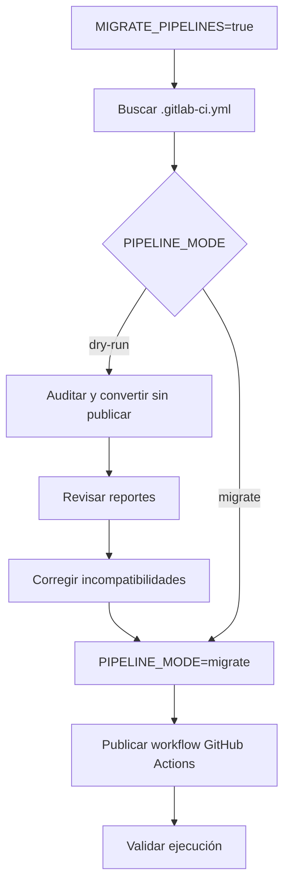

### Auditoría

```bash
export MIGRATE_PIPELINES="true"
export PIPELINE_MODE="dry-run"
export PIPELINE_BRANCHES="main,dev,qa"
export AUDIT_PIPELINES="true"
```

Con `PIPELINE_MODE=dry-run`:

- Se analiza el pipeline GitLab.
- Se generan reportes.
- No se publican workflows en GitHub.

### Migración real

```bash
export MIGRATE_PIPELINES="true"
export PIPELINE_MODE="migrate"
export PIPELINE_BRANCHES="main,dev,qa"
```

> [!TIP]
> Ejecutar primero `dry-run`, revisar los reportes y sólo después cambiar a `migrate`.

---

## 13. Logs y reportes

| Variable | Uso |
|---|---|
| `LOG_DIRECTORY` | Directorio raíz de logs y reportes. |
| `LOG_FILE` | Archivo principal de salida de la migración. |
| `PIPELINE_REPORT_DIRECTORY` | Directorio de auditorías y conversiones de pipelines. |
| `LFS_REPORT_DIRECTORY` | Directorio de reportes de blobs grandes y LFS. |
| `MEMBER_CONFLICTS_FILE` | Archivo TSV de usuarios no encontrados, no invitados o con errores. |

Ejemplo de rutas fijas:

```bash
export LOG_DIRECTORY="/opt/migraciones/logs"
export PIPELINE_REPORT_DIRECTORY="/opt/migraciones/pipelines"
export LFS_REPORT_DIRECTORY="/opt/migraciones/lfs"
export MEMBER_CONFLICTS_FILE="/opt/migraciones/logs/member-conflicts.tsv"
```

---

## 14. Configuraciones de ejemplo

### 14.1 Configuración mínima: migración Git

```bash
export GROUP_GITLAB="banco-exterior"
export GITLAB_URL="http://gitlab.bancoexterior.com"
export TOKEN_GITLAB="glpat-xxxxxxxx"
export TOKEN_GITHUB="github_pat_xxxxxxxx"

export MIGRATE_VARIABLES="false"
export MIGRATE_BRANCH_PROTECTIONS="false"
export MIGRATE_REPOSITORY_MEMBERS="false"
export MIGRATE_PIPELINES="false"

export LFS_MODE="report"
```

### 14.2 Configuración recomendada: migración completa inicial

```bash
export GROUP_GITLAB="banco-exterior"
export GITLAB_URL="http://gitlab.bancoexterior.com"
export TOKEN_GITLAB="glpat-xxxxxxxx"
export TOKEN_GITHUB="github_pat_xxxxxxxx"

export MIGRATE_VARIABLES="true"
export VARIABLES_REQUIRED="false"
export MIGRATE_ENVIRONMENT_SCOPED_VARIABLES="false"

export MIGRATE_BRANCH_PROTECTIONS="true"
export BRANCH_PROTECTIONS_REQUIRED="false"

export MIGRATE_REPOSITORY_MEMBERS="true"
export MEMBERS_REQUIRED="false"
export GITHUB_USERNAME_SUFFIX="_bexca"

export MIGRATE_PIPELINES="true"
export PIPELINE_MODE="dry-run"
export PIPELINE_BRANCHES="main,dev,qa"
export AUDIT_PIPELINES="true"
export PIPELINES_REQUIRED="false"

export LFS_MODE="report"
```

### 14.3 Configuración para repositorios específicos

```bash
export GITLAB_URL="http://gitlab.bancoexterior.com"
export TOKEN_GITLAB="glpat-xxxxxxxx"
export TOKEN_GITHUB="github_pat_xxxxxxxx"

export REPOSITORIES_FILE="banco/api-clientes,banco/canales/web,banco/notificaciones"

export MIGRATE_VARIABLES="true"
export MIGRATE_BRANCH_PROTECTIONS="true"
export MIGRATE_REPOSITORY_MEMBERS="true"

export MIGRATE_PIPELINES="false"
export LFS_MODE="report"
```

### 14.4 Configuración estricta

Utilizar cuando los procesos posteriores a Git deben completarse obligatoriamente.

```bash
export MIGRATE_VARIABLES="true"
export VARIABLES_REQUIRED="true"

export MIGRATE_BRANCH_PROTECTIONS="true"
export BRANCH_PROTECTIONS_REQUIRED="true"

export MIGRATE_REPOSITORY_MEMBERS="true"
export MEMBERS_REQUIRED="true"

export MIGRATE_PIPELINES="true"
export PIPELINE_MODE="migrate"
export PIPELINES_REQUIRED="true"
```

---

## 15. Errores frecuentes

### 15.1 Variables booleanas vacías

Incorrecto:

```bash
export MIGRATE_PIPELINES=""
```

Correcto:

```bash
export MIGRATE_PIPELINES="false"
```

También es válido no definir la variable para utilizar su valor por defecto:

```bash
unset MIGRATE_PIPELINES
```

### 15.2 Repositorio GitHub existente

Mensaje:

```text
Repositorio existente omitido
```

Para trabajar sobre el repositorio existente:

```bash
export ALLOW_MIRROR_OVERWRITE="true"
```

### 15.3 Usuario GitHub no encontrado

Ejemplo:

```text
No existe usuario GitHub equivalente para GitLab username=jperez; GitHub=jperez_bexca
```

Revisar el sufijo:

```bash
export GITHUB_USERNAME_SUFFIX="_bexca"
```

O eliminarlo:

```bash
export GITHUB_USERNAME_SUFFIX=""
```

Revisar además:

```bash
cat "${MEMBER_CONFLICTS_FILE}"
```

### 15.4 Variables con Environment Scope omitidas

Ejemplo:

```text
No existe mapeo para environment_scope=production
```

Mapeo directo:

```bash
export MIGRATE_ENVIRONMENT_SCOPED_VARIABLES="true"
export ALLOW_DIRECT_ENVIRONMENT_SCOPE_MAPPING="true"
```

Archivo de mapeo:

```bash
export ENVIRONMENT_MAPPING_FILE="./environment-mapping.tsv"
```

### 15.5 Pipeline no convertido

Ejemplo:

```text
No se encontró .gitlab-ci.yml en main; se omite conversión.
```

El script revisa inicialmente la primera rama definida en:

```bash
export PIPELINE_BRANCHES="main,dev,qa"
```

Si `.gitlab-ci.yml` está en `dev`:

```bash
export PIPELINE_BRANCHES="dev,main,qa"
```

---

## 16. Recomendaciones operativas

1. Ejecutar inicialmente con pocos repositorios.

   ```bash
   export REPOSITORIES_FILE="banco/api-clientes,banco/canales/web"
   ```

2. Activar primero la simulación general.

   ```bash
   export DRY_RUN="true"
   ```

3. Para pipelines, comenzar con:

   ```bash
   export PIPELINE_MODE="dry-run"
   ```

4. Para LFS, comenzar con:

   ```bash
   export LFS_MODE="report"
   ```

5. Revisar siempre el log principal, los reportes LFS, los reportes de pipelines y el archivo de conflictos de miembros.

6. Ejecutar la certificación post-migración antes de considerar un repositorio cerrado.

---

## 17. Criterios para pasar a certificación

Después de la migración se recomienda ejecutar el script de certificación y validar como mínimo:

```text
Ramas
Tags
Referencias
Commits
Objetos Git
Integridad Git
Rama predeterminada
Variables y Secrets
Environments
Branch Protection Rules
Miembros y permisos
Pipelines
Git LFS
```

### Gate de cierre

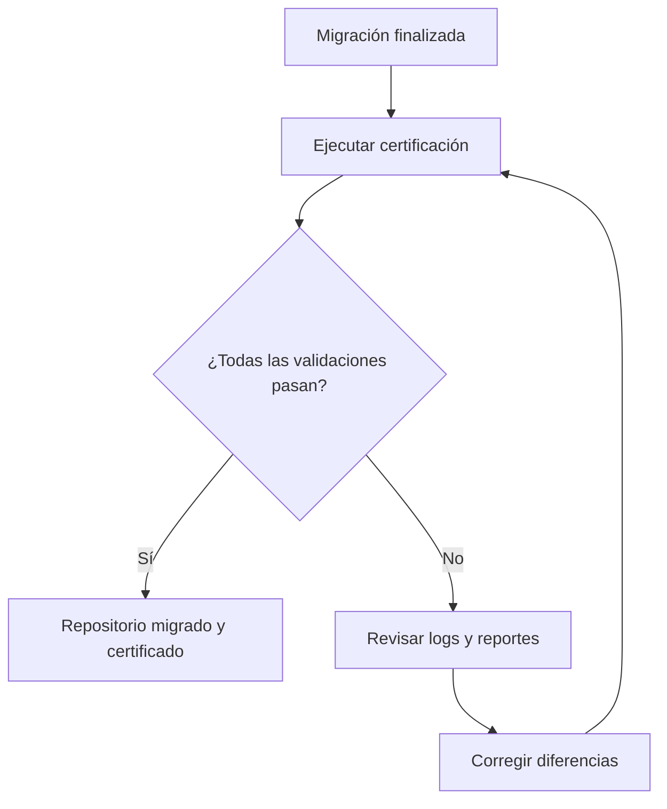

---

# PARTE II — SCRIPT 2: VALIDACIÓN / CERTIFICACIÓN

## `validar_integridad_migracion.sh`

**Objetivo:** comprobar, después de ejecutar el Script 1, que la migración GitLab → GitHub conserva la integridad esperada y que los metadatos/configuraciones habilitados quedaron correctamente disponibles en GitHub.

**Este script no migra repositorios. Su función es validar y certificar el resultado.**

---

## 18. Validación de integridad de la migración

> Script de validación: `validar_integridad_migracion.sh`

El script `validar_integridad_migracion.sh` se ejecuta **después de la migración** realizada por `migrar_repositorios.sh`.

Su objetivo es certificar que el repositorio creado en GitHub conserva la información Git esperada y que los componentes opcionales habilitados durante la migración también se encuentran disponibles en el destino.

### 18.1 Qué valida

| Dominio | Validación realizada |
|---|---|
| Ramas | Compara nombres y hashes de ramas entre GitLab y GitHub. |
| Tags | Compara tags y objetos asociados. |
| Referencias | Compara `refs/heads/*` y `refs/tags/*`. |
| Commits | Compara commits alcanzables desde ramas y tags. |
| Objetos Git | Compara objetos alcanzables desde ramas y tags. |
| Integridad Git | Ejecuta `git fsck --full --no-reflogs` en ambos repositorios. |
| Rama predeterminada | Compara GitLab y GitHub cuando `SYNC_DEFAULT_BRANCH=true`. |
| Variables y Secrets | Valida que existan en GitHub en el scope esperado. |
| GitHub Environments | Valida Environments derivados de `environment_scope`. |
| Deployment Branch Policies | Valida ramas permitidas cuando se configuraron. |
| Branch Protection | Valida reglas básicas migradas para ramas exactas. |
| Miembros | Valida usuarios y permisos mínimos esperados. |
| Pipelines | Valida reportes de auditoría y workflows de GitHub Actions. |
| Git LFS | Ejecuta `git lfs fetch --all` y `git lfs fsck` cuando corresponde. |

> [!IMPORTANT]
> El script valida el resultado de acuerdo con las mismas opciones utilizadas durante la migración. Por ejemplo, si `MIGRATE_VARIABLES=false`, la certificación no exige Variables o Secrets en GitHub.

### 18.2 Relación entre migración y certificación

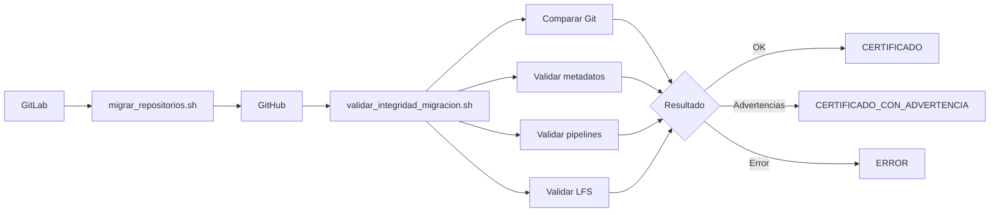

### 18.3 Cuándo ejecutar el script

Ejecutar la validación cuando:

1. La migración del repositorio haya finalizado.
2. El repositorio exista en GitHub.
3. Los procesos opcionales que se desean certificar hayan finalizado.
4. Se utilicen las mismas variables de configuración relevantes que se utilizaron durante la migración.

Ejemplo:

```bash
source migracion.env
chmod +x validar_integridad_migracion.sh
./validar_integridad_migracion.sh
```

> [!TIP]
> Para evitar diferencias de alcance, se recomienda ejecutar migración y certificación cargando el mismo archivo `migracion.env`.

### 18.4 Requisitos del script de validación

Además de los requisitos base utilizados por el migrador, el validador requiere:

```text
bash
curl
jq
git
awk
sed
diff
sort
mktemp
tee
find
grep
```

Para generar el reporte Excel se requiere Python 3.9 o posterior con `openpyxl`. Desde la carpeta `migrate`, instalar una vez:

```bash
# Windows / Git Bash
py -m pip install -r requirements-report.txt

# Linux / WSL
python3 -m pip install -r requirements-report.txt
```

El validador busca `python3`, `python` o `py` con la dependencia instalada. Se puede seleccionar otro ejecutable mediante `PYTHON_BIN`. El exportador `generar_reporte_excel.py` debe permanecer junto al validador. En Git Bash se usa `cygpath` para ejecutar Python de Windows con las rutas correctas.

Cuando `LFS_MODE=preserve` o `LFS_MODE=migrate`, también se requiere:

```text
git-lfs
```

Verificación rápida:

```bash
bash --version
curl --version
jq --version
git --version
diff --version
find --version
git lfs version
```

### 18.5 Variables obligatorias

| Variable | Descripción |
|---|---|
| `GITLAB_URL` | URL base de GitLab. |
| `TOKEN_GITLAB` | Token con acceso API y lectura de los repositorios a validar. |
| `TOKEN_GITHUB` | Token con permisos para consultar repositorios y configuración asociada. |

Ejemplo:

```bash
export GITLAB_URL="http://gitlab.bancoexterior.com"
export TOKEN_GITLAB="glpat-xxxxxxxx"
export TOKEN_GITHUB="github_pat_xxxxxxxx"
```

> [!CAUTION]
> No incluir tokens reales en el README, scripts versionados, logs compartidos ni evidencias de certificación.

### 18.6 Selección de repositorios a certificar

La selección utiliza el mismo criterio que el script de migración.

Repositorios específicos:

```bash
export REPOSITORIES_FILE="banco/api-clientes,banco/canales/web,125"
```

Grupo GitLab:

```bash
export GROUP_GITLAB="banco-exterior"
```

`REPOSITORIES_FILE` tiene prioridad sobre `GROUP_GITLAB`. Si ninguna está definida, se certifican todos los proyectos visibles para `TOKEN_GITLAB`.

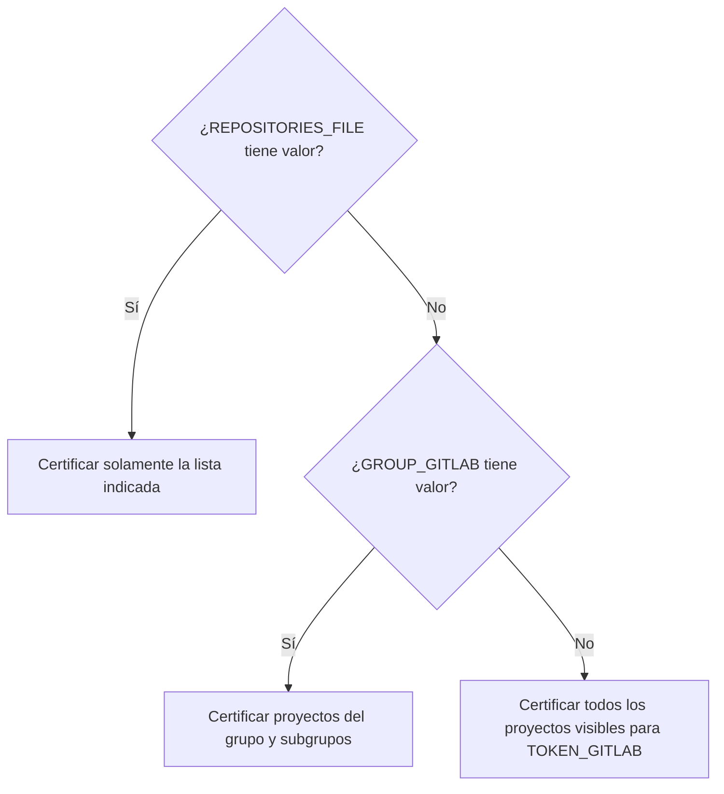

### 18.7 Variables de configuración reutilizadas

El validador reutiliza varias variables del migrador para saber **qué debe comprobar**.

| Variable | Uso durante la certificación |
|---|---|
| `SYNC_DEFAULT_BRANCH` | Valida la rama predeterminada. |
| `MIGRATE_VARIABLES` | Activa validación de Variables y Secrets. |
| `VARIABLES_REQUIRED` | Define si una diferencia de variables es `ERROR` o `ADVERTENCIA`. |
| `GITHUB_ACTIONS_VARIABLES` | Identifica qué claves deben existir como Variables y cuáles como Secrets. |
| `MIGRATE_ENVIRONMENT_SCOPED_VARIABLES` | Activa validación por GitHub Environment. |
| `CREATE_GITHUB_ENVIRONMENTS` | Mantiene la configuración esperada para Environments. |
| `CREATE_ENVIRONMENT_BRANCH_POLICIES` | Activa validación de deployment branch policies. |
| `ALLOW_DIRECT_ENVIRONMENT_SCOPE_MAPPING` | Permite resolver directamente un scope como Environment. |
| `ENVIRONMENT_MAPPING_FILE` | Resuelve scope GitLab → GitHub Environment. |
| `MIGRATE_BRANCH_PROTECTIONS` | Activa validación de protecciones de rama. |
| `BRANCH_PROTECTIONS_REQUIRED` | Convierte diferencias de protección en error cuando es `true`. |
| `MIGRATE_REPOSITORY_MEMBERS` | Activa validación de miembros. |
| `MEMBERS_REQUIRED` | Convierte diferencias de miembros en error cuando es `true`. |
| `ALLOW_GITHUB_ADMIN_PERMISSION` | Mantiene la política esperada de permisos elevados. |
| `GITHUB_USERNAME_SUFFIX` | Construye el username esperado en GitHub. |
| `LFS_MODE` | Define el tipo de validación Git/LFS. |
| `MIGRATE_PIPELINES` | Activa validación de pipelines. |
| `PIPELINE_MODE` | Define si se valida solamente auditoría o también workflows migrados. |
| `PIPELINES_REQUIRED` | Convierte diferencias de pipelines en error cuando es `true`. |
| `PIPELINE_BRANCHES` | Determina la rama inicial usada para localizar `.gitlab-ci.yml`. |
| `AUDIT_PIPELINES` | Valida que exista la auditoría de Actions Importer. |
| `PIPELINE_REPORT_DIRECTORY` | Ubicación esperada de los reportes de pipelines. |

### 18.8 Directorio y archivos de salida

Por defecto se crea un directorio similar a:

```text
./certificacion-YYYYMMDD-HHMMSS/
```

Se puede sobrescribir con:

```bash
export OUTPUT_DIRECTORY="/opt/migraciones/certificacion"
```

Archivos principales:

| Archivo | Contenido |
|---|---|
| `certificacion.log` | Log completo de ejecución. |
| `reporte-migracion.xlsx` | Libro Excel de evidencia con una hoja por repositorio, porcentaje verificado, estados e incidencias. |

### 18.9 Flujo de certificación por repositorio

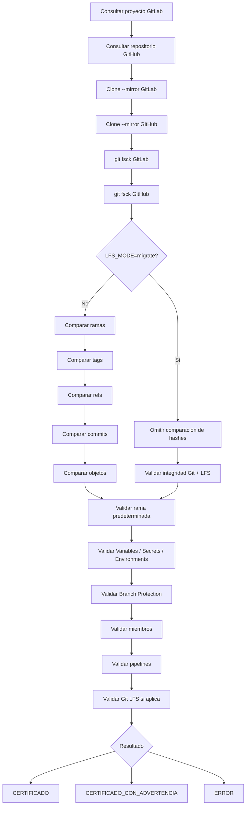

### 18.10 Validación Git

El script clona GitLab y GitHub utilizando:

```bash
git clone --mirror
```

Luego realiza las siguientes comprobaciones:

- **Ramas:** compara nombre y hash.
- **Tags:** compara tag, objeto y objeto dereferenciado.
- **Referencias:** compara `refs/heads/*` y `refs/tags/*`.
- **Commits:** compara todos los commits alcanzables desde ramas y tags.
- **Objetos Git:** compara objetos alcanzables desde las referencias migradas.
- **Integridad:** ejecuta en ambos repositorios:

```bash
git fsck --full --no-reflogs
```

Una diferencia de inventario o un error de `git fsck` provoca error de certificación.

### 18.11 Comportamiento especial de `LFS_MODE=migrate`

Cuando se utiliza:

```bash
export LFS_MODE="migrate"
```

la migración puede reescribir el historial Git. Por esa razón, los hashes originales de GitLab **no tienen por qué coincidir** con GitHub.

En ese modo, el script marca ramas, tags, referencias, commits y objetos como:

```text
NO_COMPARABLE_REESCRITURA_LFS
```

y centra la certificación en:

- integridad Git;
- disponibilidad del repositorio;
- descarga de objetos LFS;
- `git lfs fsck`;
- metadatos configurados.

> [!IMPORTANT]
> Una diferencia de hashes con `LFS_MODE=migrate` no representa por sí sola un error, porque la reescritura del historial es esperada.

### 18.12 Validación de rama predeterminada

Cuando:

```bash
export SYNC_DEFAULT_BRANCH="true"
```

se compara la rama predeterminada de GitLab con la definida en GitHub.

| Estado | Significado |
|---|---|
| `OK` | La rama coincide. |
| `DIFERENTE` | GitLab y GitHub tienen ramas predeterminadas distintas. |
| `NO_DEFINIDA_EN_GITLAB` | GitLab no informó rama predeterminada. |
| `NO_APLICA` | `SYNC_DEFAULT_BRANCH=false`. |

`DIFERENTE` provoca error de certificación.

### 18.13 Validación de Variables y Secrets

Cuando:

```bash
export MIGRATE_VARIABLES="true"
```

el script consulta las variables del proyecto GitLab y determina el destino esperado en GitHub.

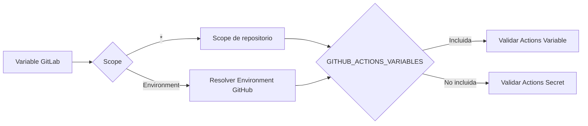

El script valida que cada Variable o Secret esperado **exista** en el scope correcto.

> [!IMPORTANT]
> La API de GitHub no permite recuperar el valor en texto plano de un Secret. Por ello, la certificación valida la **existencia y ubicación** del Secret, pero no puede comparar su valor con GitLab.

El script actual tampoco compara el contenido de una GitHub Actions Variable con el valor original de GitLab; valida principalmente su existencia en el endpoint esperado.

### 18.14 Validación de GitHub Environments

Si una variable GitLab tiene `environment_scope` distinto de `*` y:

```bash
export MIGRATE_ENVIRONMENT_SCOPED_VARIABLES="true"
```

se resuelve el GitHub Environment mediante `ENVIRONMENT_MAPPING_FILE` o `ALLOW_DIRECT_ENVIRONMENT_SCOPE_MAPPING=true`.

Ejemplo:

```text
dev|development|dev
qa|quality-assurance|qa
production|production|main
```

Si además:

```bash
export CREATE_ENVIRONMENT_BRANCH_POLICIES="true"
```

el script comprueba las ramas configuradas como `deployment branch policies` del Environment correspondiente.

### 18.15 Validación de Branch Protection Rules

Cuando:

```bash
export MIGRATE_BRANCH_PROTECTIONS="true"
```

el script valida para cada rama protegida exacta:

- existencia de protección en GitHub;
- `allow_force_push`;
- exigencia de Code Owners;
- al menos una aprobación cuando Code Owners es obligatorio.

Reglas wildcard como:

```text
release/*
feature/*
```

se registran como advertencia porque el migrador no las transforma automáticamente en una protección exacta equivalente.

> [!NOTE]
> Esta certificación cubre las protecciones básicas manejadas por el migrador. No sustituye una revisión completa de GitHub Rulesets.

### 18.16 Validación de miembros y permisos

Cuando:

```bash
export MIGRATE_REPOSITORY_MEMBERS="true"
```

el script consulta los miembros GitLab y construye el username esperado en GitHub usando `GITHUB_USERNAME_SUFFIX`.

```text
GitLab: jperez
Sufijo: _bexca
GitHub: jperez_bexca
```

Luego valida que el usuario tenga al menos el permiso esperado.

| Nivel GitLab | Permiso mínimo GitHub |
|---|---|
| Guest | `pull` |
| Reporter | `pull` |
| Developer | `push` |
| Maintainer | `maintain` |
| Owner | `maintain` |

Jerarquía utilizada:

```text
pull < triage < push < maintain < admin
```

Un permiso superior al esperado es aceptado. Un permiso inferior genera incidencia.

### 18.17 Validación de pipelines

Cuando:

```bash
export MIGRATE_PIPELINES="true"
```

la validación depende de `PIPELINE_MODE`.

#### `PIPELINE_MODE=dry-run`

El script valida principalmente que exista la auditoría esperada en:

```text
${PIPELINE_REPORT_DIRECTORY}/${repository}/audit
```

#### `PIPELINE_MODE=migrate`

Además de la auditoría, comprueba:

1. La primera rama indicada en `PIPELINE_BRANCHES`.
2. Si esa rama contiene `.gitlab-ci.yml`.
3. Si GitHub contiene al menos un workflow de GitHub Actions.

Ejemplo:

```bash
export PIPELINE_BRANCHES="main,dev,qa"
```

En este caso, la rama inicial evaluada es `main`.

> [!WARNING]
> El script actual usa la **primera rama** definida en `PIPELINE_BRANCHES` para determinar si existe `.gitlab-ci.yml`. Si el pipeline está únicamente en otra rama, coloca esa rama primero antes de ejecutar la certificación.

Ejemplo:

```bash
export PIPELINE_BRANCHES="dev,main,qa"
```

### 18.18 Validación de Git LFS

Cuando `LFS_MODE=preserve` o `LFS_MODE=migrate`, el script ejecuta sobre GitHub:

```bash
git lfs fetch --all origin
git lfs fsck
```

Si no es posible descargar todos los objetos o `git lfs fsck` detecta inconsistencias, la certificación falla.

Cuando:

```bash
export LFS_MODE="report"
```

el estado LFS queda como:

```text
NO_APLICA_REPORT
```

### 18.19 Repositorios vacíos

Si el repositorio GitLab no contiene referencias Git, el script evita exigir algunos procesos que el migrador original no ejecuta para repositorios vacíos.

Los siguientes componentes pueden quedar como:

```text
NO_APLICA_REPOSITORIO_VACIO
```

- Branch Protection.
- Miembros.
- Pipelines.

### 18.20 Errores requeridos vs. advertencias

El comportamiento de varias validaciones depende de variables `*_REQUIRED`.

Ejemplo:

```bash
export MIGRATE_VARIABLES="true"
export VARIABLES_REQUIRED="false"
```

Una diferencia de variables se registra como `ADVERTENCIA`.

Con:

```bash
export VARIABLES_REQUIRED="true"
```

la misma diferencia se convierte en `ERROR`.

| Componente | Variable de exigencia |
|---|---|
| Variables / Secrets / Environments | `VARIABLES_REQUIRED` |
| Branch Protection | `BRANCH_PROTECTIONS_REQUIRED` |
| Miembros | `MEMBERS_REQUIRED` |
| Pipelines | `PIPELINES_REQUIRED` |
| Integridad Git | Siempre requerida |
| Git LFS en `preserve/migrate` | Siempre requerida |

### 18.21 Estados finales por repositorio

El resumen final y el Excel incluyen un porcentaje verificado por repositorio: comprobaciones en `OK` divididas entre comprobaciones aplicables, con igual peso y redondeo a dos decimales. Por ejemplo, 8 comprobaciones correctas de 10 aplicables representan 80%.

Las advertencias, errores, estados `NO_EVALUADO` y hashes no comparables tras reescritura LFS no suman al porcentaje. Los estados `NO_APLICA*` se excluyen del denominador; si no hay comprobaciones aplicables, se muestra `N/D`. Si el repositorio falla antes de poder certificarse, se muestra 0% verificado, no una afirmación de que esté vacío.

Este indicador mide comprobaciones completas, no bytes, archivos ni elementos individuales dentro de cada componente. Un 100% significa que pasaron todas las comprobaciones aplicables al alcance configurado, no que se hayan validado funcionalidades fuera de ese alcance ni valores de Secrets que GitHub no expone.

| Resultado | Significado |
|---|---|
| `CERTIFICADO` | No se detectaron errores ni advertencias relevantes. |
| `CERTIFICADO_CON_ADVERTENCIA` | Git es válido, pero existen advertencias de metadatos o configuración. |
| `ERROR` | Existen diferencias Git o fallas consideradas obligatorias. |

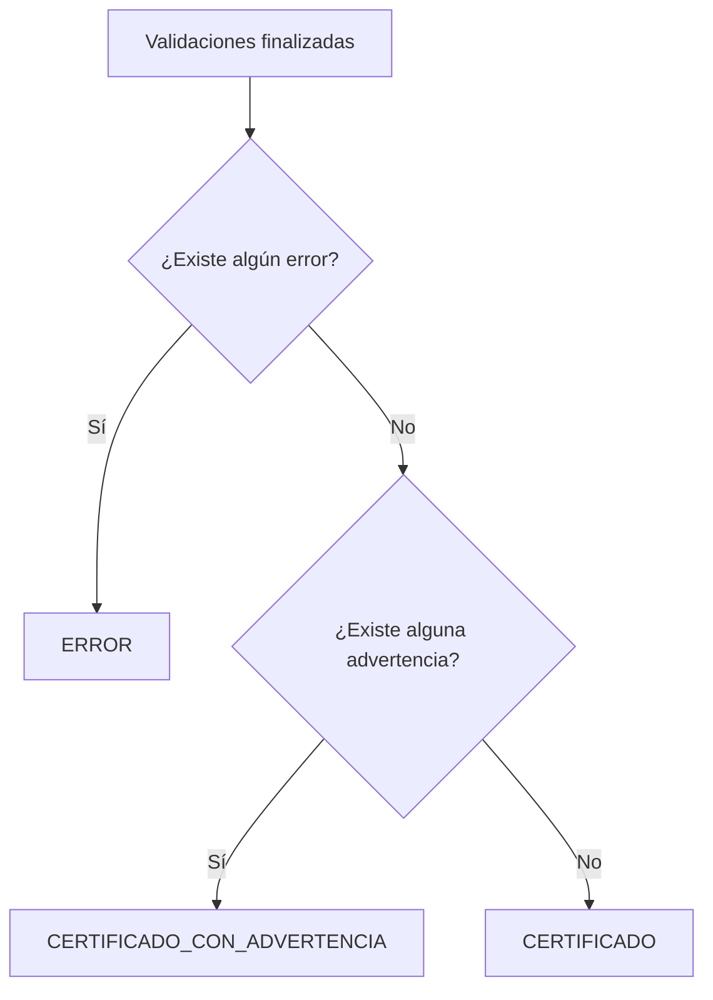

### 18.22 Código de salida

Al finalizar:

- si existe al menos un proyecto con `ERROR`, el script termina con código distinto de cero;
- si sólo existen advertencias, termina correctamente;
- si todos los proyectos están certificados, termina correctamente.

Ejemplo:

```bash
if ./validar_integridad_migracion.sh; then
  echo "Certificación sin errores bloqueantes"
else
  echo "La certificación detectó errores"
fi
```

### 18.23 Reporte Excel

El archivo `reporte-migracion.xlsx` contiene exactamente una hoja por repositorio. Un grupo de tres repositorios genera un solo libro con tres hojas, incluidos los repositorios que fallen antes de terminar la validación.

Cada hoja muestra:

| Sección | Contenido |
|---|---|
| Identificación | Repositorio, cuenta GitHub, grupo GitLab y fechas. |
| Porcentaje verificado | Porcentaje y número de comprobaciones correctas frente a las aplicables. |
| Comprobaciones | Componente, estado técnico, resultado legible y si cuenta en el porcentaje. |
| Incidencias | Errores, advertencias, etapa, mensaje y evidencia disponible. |
| Trazabilidad | Resultado, alcance y ruta del log de ejecución. |

Los nombres de hojas largos o incompatibles con Excel se ajustan sin perder el nombre original dentro de la hoja. El JSON se usa únicamente como dato temporal interno; la evidencia entregada es el Excel y el log. El archivo también se genera cuando hay errores de certificación; esos errores mantienen el código de salida no cero.

El Excel refleja las comprobaciones que implementa el validador, no certifica campos fuera de su alcance. No muestra ni compara valores de Secrets que GitHub no permite recuperar.

Por repositorio se registran estados para:

```text
ramas
tags
referencias
commits
objetos
integridad_gitlab
integridad_github
rama_predeterminada
variables_y_secrets
environments
protecciones_de_rama
miembros_y_permisos
pipelines
lfs
```

### 18.24 Ejemplo de certificación básica

```bash
export GITLAB_URL="http://gitlab.bancoexterior.com"
export TOKEN_GITLAB="glpat-xxxxxxxx"
export TOKEN_GITHUB="github_pat_xxxxxxxx"

export REPOSITORIES_FILE="banco/api-clientes,banco/canales/web"
export SYNC_DEFAULT_BRANCH="true"

export MIGRATE_VARIABLES="false"
export MIGRATE_BRANCH_PROTECTIONS="false"
export MIGRATE_REPOSITORY_MEMBERS="false"
export MIGRATE_PIPELINES="false"
export LFS_MODE="report"

./validar_integridad_migracion.sh
```

Esta configuración valida principalmente ramas, tags, referencias, commits, objetos Git, integridad GitLab/GitHub y rama predeterminada.

### 18.25 Ejemplo de certificación completa

```bash
export GITLAB_URL="http://gitlab.bancoexterior.com"
export TOKEN_GITLAB="glpat-xxxxxxxx"
export TOKEN_GITHUB="github_pat_xxxxxxxx"

export GROUP_GITLAB="banco-exterior"
export SYNC_DEFAULT_BRANCH="true"

export MIGRATE_VARIABLES="true"
export VARIABLES_REQUIRED="true"
export MIGRATE_ENVIRONMENT_SCOPED_VARIABLES="true"
export CREATE_GITHUB_ENVIRONMENTS="true"
export CREATE_ENVIRONMENT_BRANCH_POLICIES="true"
export ENVIRONMENT_MAPPING_FILE="./environment-mapping.tsv"

export MIGRATE_BRANCH_PROTECTIONS="true"
export BRANCH_PROTECTIONS_REQUIRED="true"

export MIGRATE_REPOSITORY_MEMBERS="true"
export MEMBERS_REQUIRED="true"
export GITHUB_USERNAME_SUFFIX="_bexca"

export MIGRATE_PIPELINES="true"
export PIPELINE_MODE="migrate"
export PIPELINES_REQUIRED="true"
export AUDIT_PIPELINES="true"
export PIPELINE_BRANCHES="main,dev,qa"
export PIPELINE_REPORT_DIRECTORY="/opt/migraciones/pipelines"

export LFS_MODE="preserve"
export OUTPUT_DIRECTORY="/opt/migraciones/certificacion"

./validar_integridad_migracion.sh
```

### 18.26 Interpretación operativa del resultado

**Certificación exitosa**

```text
RESULTADO FINAL: CERTIFICACIÓN EXITOSA.
```

No se detectaron diferencias Git ni errores de metadatos configurados.

**Certificación exitosa con advertencias**

```text
RESULTADO FINAL: CERTIFICACIÓN EXITOSA CON ADVERTENCIAS.
```

La migración Git es válida, pero existe al menos una diferencia no configurada como bloqueante.

**Certificación con errores**

```text
RESULTADO FINAL: CERTIFICACIÓN CON ERRORES.
```

Existe al menos una diferencia Git o falló una validación marcada como requerida. El repositorio no debe considerarse certificado hasta resolver la incidencia.

---

# PARTE III — EJECUCIÓN CONJUNTA

Esta parte muestra cómo utilizar **el Script 1 y luego el Script 2** como un único proceso operativo de migración y certificación.

---

## 19. Ejecución recomendada de punta a punta

La secuencia operativa recomendada para utilizar ambos scripts es:

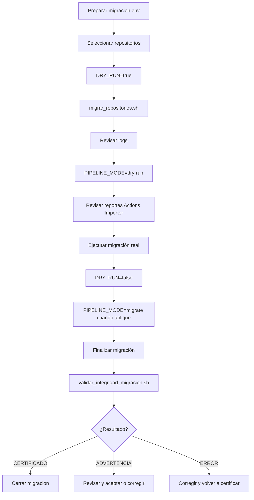

Secuencia práctica:

```bash
source migracion.env
./migrar_repositorios.sh
./validar_integridad_migracion.sh
```

### Gate de cierre recomendado

Un repositorio puede considerarse migrado cuando:

- la migración finalizó sin errores bloqueantes;
- `validar_integridad_migracion.sh` devuelve `CERTIFICADO`; o
- las advertencias de `CERTIFICADO_CON_ADVERTENCIA` fueron revisadas y aceptadas formalmente;
- los logs y el Excel de certificación fueron almacenados como evidencia.

```text
Migración ejecutada
        │
        ▼
Certificación técnica
        │
        ├── ERROR ───────────────► Corregir
        │                            │
        │                            └──► Certificar nuevamente
        │
        ├── ADVERTENCIA ─────────► Revisar / aceptar / corregir
        │
        └── CERTIFICADO ─────────► Cierre
```

---

## Resumen rápido

```text
GitLab
  │
  ├── Repositorios
  ├── Ramas / Tags / Commits
  ├── Variables / Secrets
  ├── Environment Scopes
  ├── Branch Protection
  ├── Miembros
  ├── Git LFS
  └── GitLab CI/CD
          │
          ▼
migrar_repositorios.sh
          │
          ▼
GitHub
  ├── Repositorios privados
  ├── Ramas / Tags / Historial
  ├── Actions Variables / Secrets
  ├── Environments
  ├── Branch Protection
  ├── Colaboradores
  ├── Git LFS
  └── GitHub Actions
          │
          ▼
Logs + reportes
          │
          ▼
validar_integridad_migracion.sh
  ├── Git / fsck
  ├── Rama predeterminada
  ├── Variables / Secrets
  ├── Environments
  ├── Branch Protection
  ├── Miembros
  ├── Pipelines
  └── Git LFS
          │
          ▼
CERTIFICADO / ADVERTENCIA / ERROR
```
